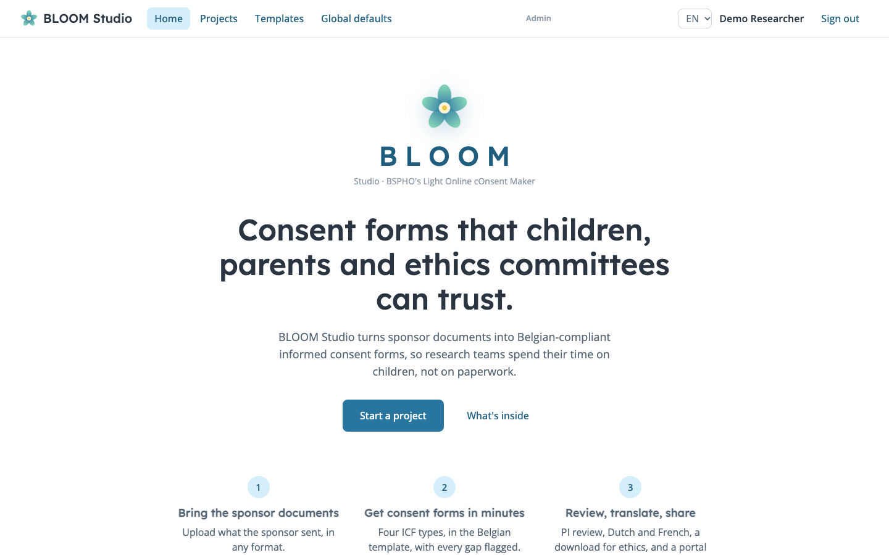
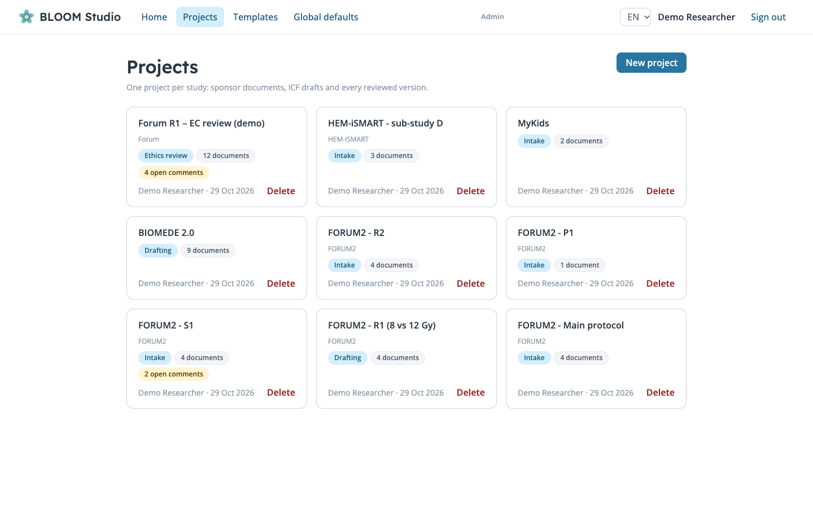
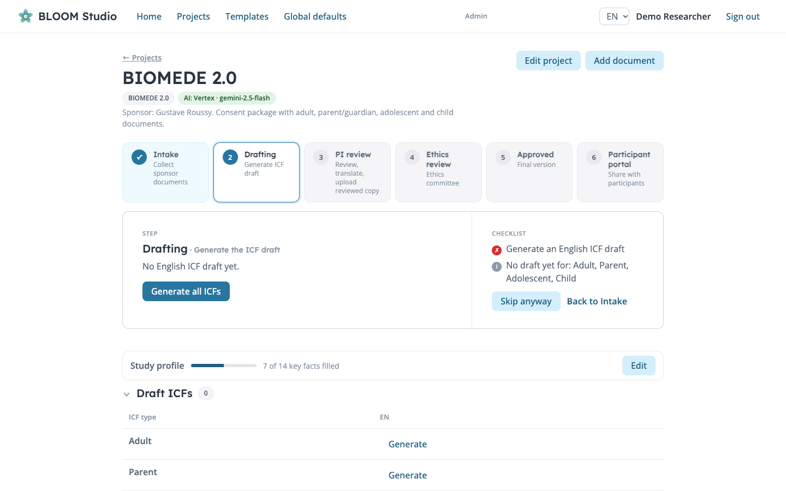
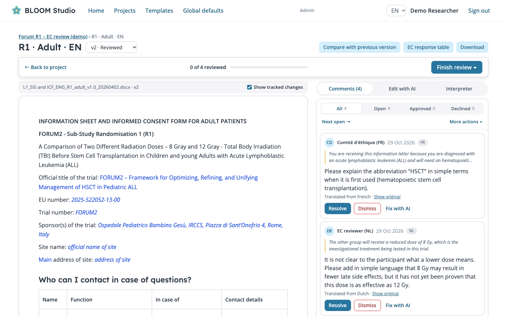
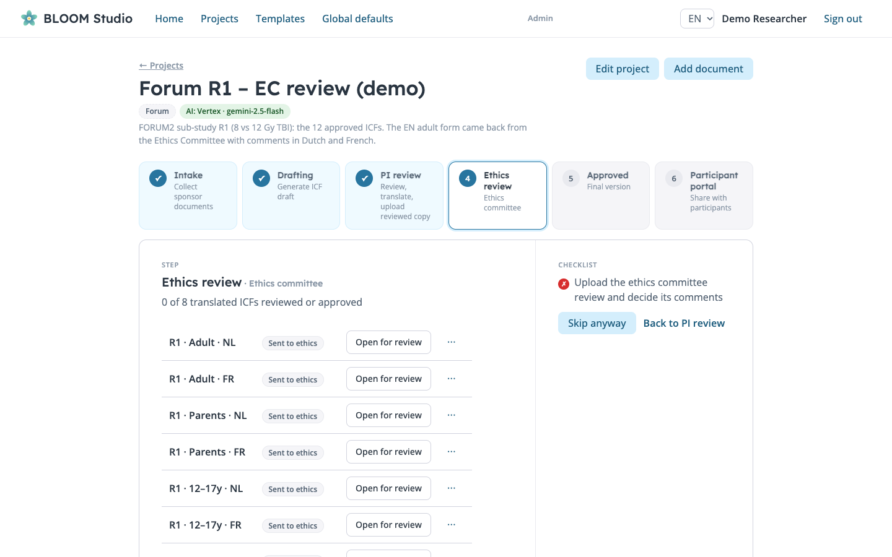
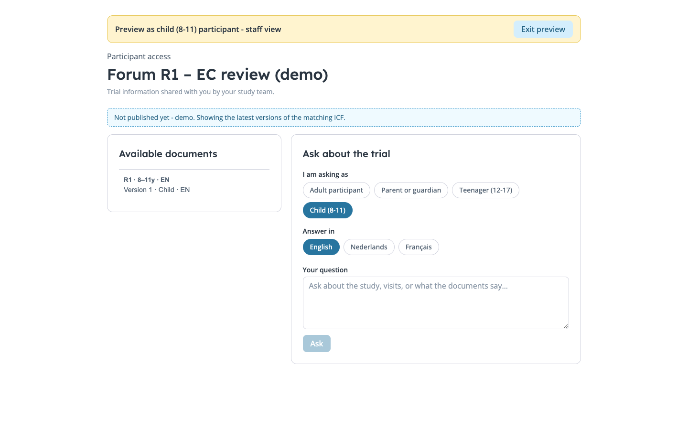
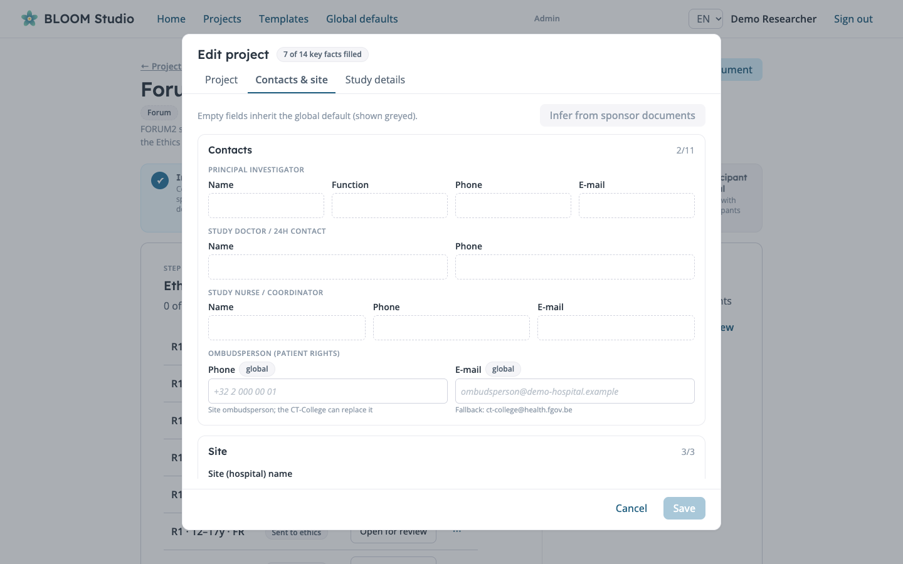
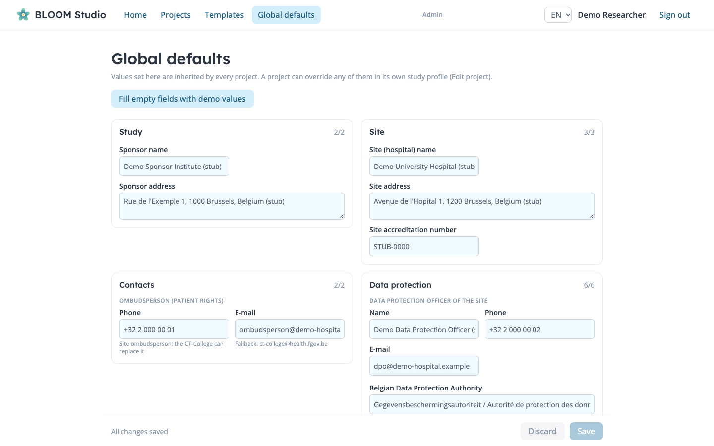
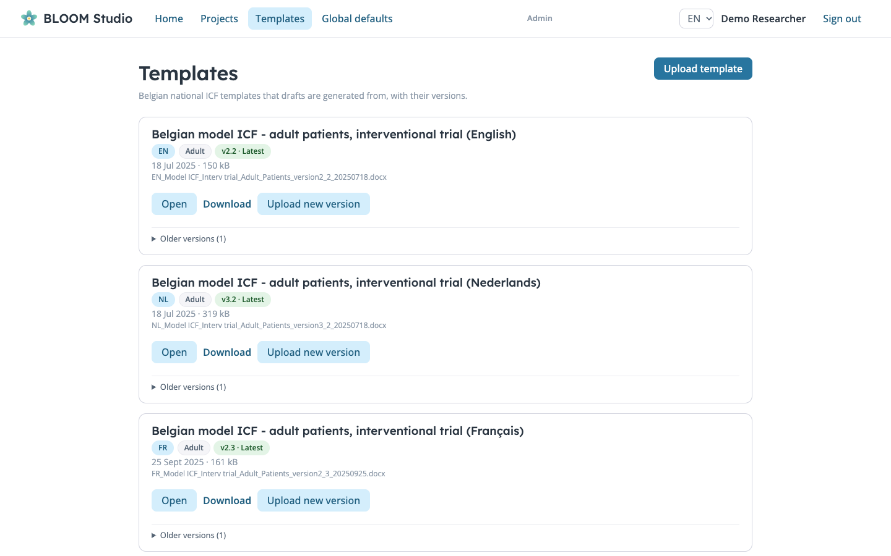
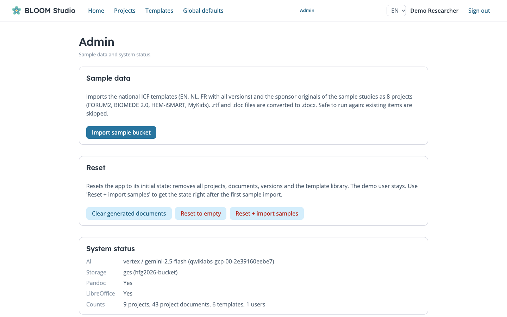

# BLOOM Studio

*BSPHO's Light Online cOnsent Maker* · built at **Hacking for Good** for the Belgian Society for Paediatric Haemato-Oncology (BSPHO).

BLOOM Studio turns sponsor documents into **Belgian-compliant informed consent forms (ICFs)**: four ICF types (adult, parent, adolescent 12-17, child 8-11) in English, Dutch and French, as Word files. AI fills the mandatory national template, flags every gap and every edit to mandatory text for human review, and the app carries the documents through PI review, translation and ethics-committee review up to a participant portal.



## How a study moves through BLOOM Studio

Receive sponsor documents → **create English ICFs** → PI review → **translate to NL and FR** → ethics committee review → approval → share with participants. Each step below is a stage of the project wizard.

### 1. Projects
One project per study, with its sponsor documents, ICF drafts and every reviewed version.



### 2. Drafting: create the English ICFs
Upload sponsor documents (docx, doc, rtf, pdf), then **Generate all ICFs**. Creation is always English; the NL/FR table only appears after PI review. The study profile (contacts, site, insurer) feeds the generator, so those placeholders get filled instead of flagged.



### 3. PI review: comments, staged edits, finish review
Open a draft in the browser with Word comments and tracked changes. Gaps come with "Provide the text", "Fix with AI" or "Leave as placeholder". Decisions are staged and applied in one go with a GitHub-style **Finish review** (save changes, approve the document, or request changes). Select text to add your own comment, and use the Interpreter tab to ask questions about the document.



### 4. Ethics review
Download everything as a zip (or per language), send it out, and upload reviewed copies back as new versions. Approve documents one by one or all at once.



### 5. Participant portal
Publish approved versions to invited families. **Preview the portal as** an adult, parent, adolescent or child to try the experience, including the interpreter that answers questions in simple language, with sources.



### Project and global data
Contact details, site and insurer information are tracked once: per project (Edit project) and as BSPHO-wide defaults that projects inherit and can override. The PI review stage flags when they are not complete.




### Templates and admin
The template library keeps the Belgian EN/NL/FR national templates with versions (upload a new version, then use **Update to latest template** on older ICFs). Admin has system status, sample import and reset options.




## Features
- **Three modes** from the briefing: creation (English), translation (mixed: NL/FR template wording plus translated content), update (rebuild an ICF on the latest template).
- **Section-level AI generation** (Vertex AI): strong model for writing, fast model for extraction, review pass; table of contents left intact; gaps become Word comments.
- **Review**: Word comments and tracked changes rendered in the browser, version diff, comments translated to your language, "Edit with AI" chat with propagation to the other language versions.
- **Workflow**: stage tracker with requirement gates (and "Skip anyway"), approve-as-is, document status chips, bulk zip export.
- **Study profile**: per-project and global facts used in generation.
- **Participant portal** with a read-only ICF interpreter.
- UI in EN, NL and FR. Demo login: `demo@bspho.be` / `demo1234`.

Open items: adolescent and child ICFs still use the adult template (HIRUZ templates not available), illustrations for child ICFs, frontend deployment, quality evaluation of AI-filled text against the approved ICFs (`scripts/eval_icf/`).

---

# Background: the assignment

Source: organizers' briefing, `docs/briefing-bspho-icfs.pptx` (text: `docs/briefing-bspho-icfs.md`).

## The problem
Clinical studies require an **Informed Consent Form (ICF)**: it describes the study (treatments, procedures such as blood draws or biopsies) to the participant, is a mandatory part of Good Clinical Practice, and documents that the participant understood what is required of them.

**BSPHO** (Belgian Society for Paediatric Haemato-Oncology, 7 Belgian centres) prepares the ICFs for ethics-committee submission, based on documents from the study **sponsor**. Today this is manual work.

## ICF types
| Type | How it is made |
|---|---|
| Adult | Mandatory Belgian template + sponsor documents + extra admin info (insurer, principal investigator, ...) |
| Parental | Adapted from the Adult ICF ("you" → "your child") |
| Adolescent (12–17) | Sponsor's adolescent ICF + HIRUZ (UZ Gent) adolescent template; simpler, informal, no administrative info |
| Children (8–11) | Sponsor's children's ICF + HIRUZ children's template; ~2 pages, basic, with illustrations |

Each type must exist in **English, Dutch and French**. English is made first, reviewed by the Principal Investigator, then translated to NL and FR.

## Why the Belgian template is hard
- Assumes commercial studies of new molecules in adults; paediatric academic studies (existing molecules, minors) need some adaptation of mandatory text.
- Must be followed in all three languages, so direct translation is not possible.
- 40+ pages with template text and instructions interleaved: guidance, instructions, mandatory, proposed and placeholder text, distinguished by colour in one docx.
- Changes over time; existing ICFs sometimes must be updated.

## Desired flow
Receive sponsor documents → create EN ICFs → PI review → adjustments → translate to FR & NL → (new template version uploaded → update earlier ICFs) → ethics committee review → adjustments → approval.

## Requested solution
**Must have:** a deployable web application with the templates (new versions can be uploaded) and three modes:
- **Creation** – input: sponsor documents + additional info (docx, pdf, free text); output: the 4 ICF types in English (docx). Fills the template, clearly marks edits to mandatory text and gaps for human review; uses free illustrations or placeholders for children's ICFs.
- **Translation** – input: the 4 English ICFs (may include manual edits); output: the 4 ICFs in NL and FR, using the mandatory wording of the NL/FR templates plus translated text from the English input.
- **Update** – input: the 4 ICFs in EN/FR/NL made on an older template; output: the same on the latest template version.

**Nice to have:** interactive human-in-the-loop creation, image generation for children's ICFs, text simplification tool, text translation tool, ICFs for non-medical studies (observational / with interventions; different templates).

**Organizers' advice:** study how the colour-coded template is structured and break it into modular pieces; build that transformation into the application so it can be reused for future template versions.

## Provided sources
- Belgian adult ICF template, EN/FR/NL
- HIRUZ templates for adolescents and children, EN/FR/NL
- HIRUZ templates for non-medication studies, EN/FR/NL
- Previously created ICFs, including sponsor documents
- Sample illustrations for children's ICFs
- Mock UHMEP e-prescription API (`Pediatric Prescriber/` in the bucket)

## Repository layout
```
README.md          this file
CLAUDE.md          instructions for Claude Code sessions
docs/              organizers' briefing (pptx + markdown text)
data/bucket.zip    original files from the GCP bucket, unchanged
data/text/         plain-text conversions of the bucket documents
memory/notes/      analysis notes on the bucket documents
scripts/convert.sh converts docx/doc/rtf/pdf/pptx to text
```
Bucket contents: `National Templates/` (Belgian adult model ICF, EN/FR/NL, two versions), example studies `Forum`, `Biomede`, `HEM-iSmart` (sponsor originals + approved ICFs), `Additional Materials` (MyKids, non-medical templates, icons), `Pediatric Prescriber/` (mock API zip).

## Running the app

BLOOM Studio: FastAPI backend (`backend/`, SQLite) + Vite/React frontend (`frontend/`). Requires `uv` and Node.

```
make install   # deps
make dev       # backend :8010 + frontend :5173 (Ctrl-C stops both)
make lint      # ruff + biome + tsc
make fmt       # auto-fix
make clean-db  # reset db and uploads
make demo      # with the servers running: seed demo project, AI draft and a reviewed v2 with comments
```

Environment (backend): `STORAGE_BACKEND=local|gcs` (`make dev` defaults to `gcs`; `make dev STORAGE_BACKEND=local` keeps files in `backend/storage/`),
`GCS_BUCKET` (default `hfg2026-bucket` in the Makefile; required for `gcs`, uses Application Default Credentials: `gcloud auth application-default login`),
`ICF_DB_PATH` (SQLite file, default `backend/icf.db`; use separate files for parallel dev servers). SQLite holds metadata only; documents live in the bucket
(`templates/...`, `projects/<id>/<doc>/v<n>-...`). `make clean-db` does not delete bucket objects.

Backend container (bundles LibreOffice for .doc/.rtf -> .docx conversion; pandoc comes with `pypandoc-binary`; the converter chain in `backend/app/convert.py` is pluggable, e.g. a Google Drive fallback could be added):
```
docker build -t bloom-studio-backend backend
docker run -p 8010:8010 -e STORAGE_BACKEND=gcs -e GCS_BUCKET=<bucket> bloom-studio-backend
```
`GET /api/admin/status` reports AI, storage and converter availability.

Open http://localhost:5173 (API docs at http://localhost:8010/docs), then click "Import sample bucket".
